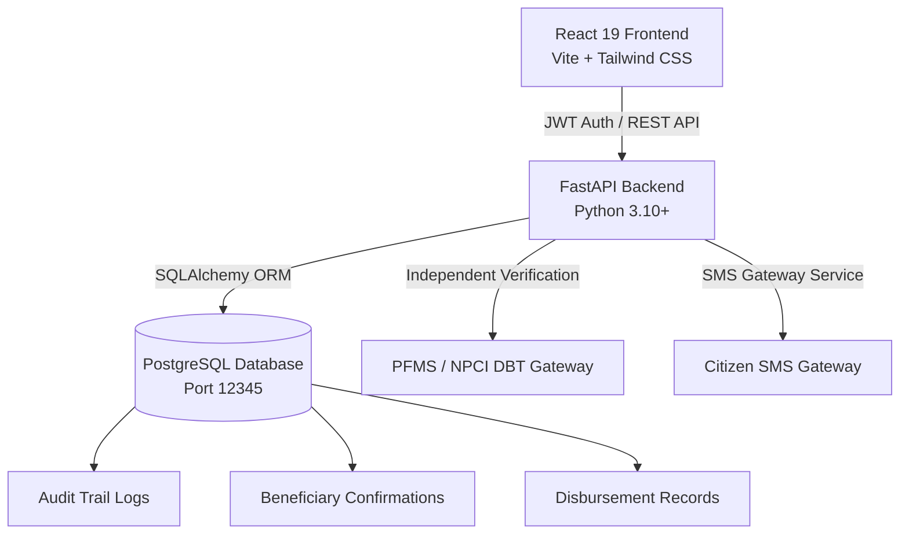

# BenefitLens: Transparent Government Benefit Disbursement Tracker

> **Tagline:** Making Government Benefits Transparent, Traceable, and Accountable.

BenefitLens is a transparent government benefit disbursement tracking and auditing system designed to ensure integrity, accountability, and citizen trust in Direct Benefit Transfer (DBT) welfare programs. 

Unlike traditional static scheme portals that merely list scheme guidelines, BenefitLens establishes an end-to-end mathematical and evidentiary audit bridge between official government sanction orders, banking disbursement gateways (PFMS / NPCI), and citizen-reported ground realities.

---

## 🎯 Core Project Objectives Answered

BenefitLens directly answers the seven fundamental questions required by beneficiaries and government administrators:

1. **Which government benefits is the beneficiary eligible for?**
   - Deterministic rule engine evaluates 10 demographic and socio-economic parameters (age, income ceiling, state jurisdiction, occupation, landholding, social category, education, gender) against genuine Central and State scheme guidelines.
2. **How much benefit amount has been sanctioned?**
   - Tracks official department sanction orders and statutory entitlement amounts (e.g., ₹2,000 per installment for PM-KISAN; ₹1,20,000 for PMAY-Gramin housing grant).
3. **How much amount has been disbursed?**
   - Tracks actual funds transferred through Direct Benefit Transfer (DBT) banking channels.
4. **How much amount is pending?**
   - Automated mathematical calculation: `Pending Amount = Sanctioned Amount - Disbursed Amount`.
5. **Does the received amount match the sanctioned amount?**
   - Automated discrepancy detection: `Discrepancy = Sanctioned Amount - Amount Received`. If a shortfall exists, the record is immediately tagged with a high-priority "Discrepancy Detected" alert.
6. **What is the payment date and current verification status?**
   - Displays exact payment dates, bank UTR reference numbers, and current PFMS independent verification status.
7. **Does a payment discrepancy need administrative attention?**
   - Beneficiaries can file structured discrepancy claims directly from their ledger; administrators receive them in a dedicated Discrepancy Scrutiny Queue for investigation and reconciliation.

---

## 🛡️ Critical Design & Governance Principles

### 1. Separation of Beneficiary Confirmation vs. Independent PFMS Verification
BenefitLens strictly avoids fabricating payments or treating citizen self-reports as bank truth:
- **Beneficiary Confirmation (Self-Reported):** Recorded as citizen claims (`Confirmed Received`, `Reported Partial Amount`, `Reported Not Received`).
- **PFMS Banking Verification (Independent Truth):** Verified against the Public Financial Management System (PFMS), State Treasuries, and NPCI Aadhaar Payment Bridge (APB) with official UTR numbers.

### 2. Strict Aadhaar Privacy Compliance
In compliance with the Aadhaar Act 2016 and India Digital Personal Data Protection (DPDP) Act:
- Zero raw 12-digit Aadhaar numbers are ever stored in plaintext.
- Displayed exclusively as masked tokens: `XXXX-XXXX-4819`.
- Deduplication is performed using cryptographically salted SHA-256 hashes.

### 3. Genuine Government Schemes (Zero Mock Data)
All schemes are verified from official sources:
- [myscheme.gov.in](https://www.myscheme.gov.in/)
- [pmkisan.gov.in](https://pmkisan.gov.in/)
- [pmjay.gov.in](https://pmjay.gov.in/)
- [pmayg.nic.in](https://pmayg.nic.in/)
- [scholarships.gov.in](https://scholarships.gov.in/)
- [pmsvanidhi.mohua.gov.in](https://pmsvanidhi.mohua.gov.in/)

---

## 🏗️ Architecture & Technology Stack



- **Frontend:** React 19, Vite, Tailwind CSS with curated Navy Blue (`#0a192f` to `#1e3a8a`), Emerald Teal (`#0d9488`), and clean slate neutral design system, Lucide icons, Canvas Confetti.
- **Backend:** FastAPI (Python), Pydantic v2 schemas, SQLAlchemy ORM, BCrypt password hashing, PyJWT authentication.
- **Database:** PostgreSQL on local port `12345` with database `benefit_govt_db`.
- **SMS Gateway:** Automated event-driven SMS dispatcher with notification audit table.

---

## 🗄️ Database Models & Schema

1. **`schemes`**: Genuine welfare schemes with title, code, ministry, level (Central/State), state, category, benefit description, `sanctioned_amount_default`, eligibility boundaries, and `verified_source_url`.
2. **`users` & `citizen_profiles`**: Beneficiary and officer credentials, masked Aadhaar tokens, salted hashes, annual family income, occupation, education, caste category, and bank details.
3. **`applications`**: Scheme applications with unique Application Reference Numbers (e.g. `ARN-2026-48291`), multi-stage verification timelines, `sanctioned_amount`, and digital acknowledgement proof URLs.
4. **`benefit_payment_records`**: Detailed DBT records with `sanctioned_amount`, `amount` (disbursed), `expected_amount`, `pending_amount`, `amount_reported_received`, `discrepancy_amount`, `discrepancy_status`, `verification_status` (PFMS), UTR number, and masked bank accounts.
5. **`beneficiary_confirmations`**: Citizen self-reported receipt confirmations and discrepancy filings with passbook notes, underpayment details, and admin review status (`Under Investigation`, `Claim Reconciled`, `Claim Disputed`).
6. **`payment_audit_logs`**: Immutable transaction history capturing actor name, actor role, timestamp, old status, new status, and evidentiary references.
7. **`notifications`**: Automated SMS logs dispatched on scheme launches, status updates, and discrepancy filings.

---

## 👥 Demo User Accounts (Pre-Seeded)

The database includes pre-seeded accounts covering all roles and edge cases (including partial payments and discrepancy audits):

| Role | Name | Phone / Login | Password | Context |
| :--- | :--- | :--- | :--- | :--- |
| **Beneficiary (Farmer)** | Rajesh Kumar Verma | `9876543210` | `password123` | PM-KISAN (₹2,000 credited), PMAY-Gramin (₹40,000 first installment received out of ₹1,20,000 sanctioned; ₹80,000 pending), Post-Matric Scholarship (₹6,000 sanctioned, ₹2,000 received; ₹4,000 discrepancy under investigation). |
| **Nodal Officer** | Pooja Deshmukh | `9823011223` | `password123` | Madhya Pradesh Social Welfare Nodal Officer for desk review and scrutiny. |
| **IAS Central Admin** | Dr. Rameshwar Singh IAS | `9412000001` | `admin123` | Mission Director, DBT & Public Financial Transparency. Access to full analytics, disbursement creation, and discrepancy adjudication. |

---

## 🚦 Getting Started & Running Locally

### Prerequisites
- Python 3.10+
- Node.js 18+
- PostgreSQL 14+ running on port `12345` with database `benefit_govt_db`

### 1. Database Initialization
Seed genuine schemes, demo users, applications, payments, and audit logs:
```bash
cd backend
python seed_db.py
```

### 2. Start the Backend API (FastAPI)
```bash
cd backend
python -m uvicorn app.main:app --host 127.0.0.1 --port 8000
```
- API Base URL: `http://127.0.0.1:8000`
- Interactive OpenAPI Docs: `http://127.0.0.1:8000/docs`
- Health Endpoint: `http://127.0.0.1:8000/api/v1/health`

### 3. Start the Frontend Application (React + Vite)
```bash
cd frontend
npm run dev -- --host 127.0.0.1 --port 5173
```
- Web Application: `http://127.0.0.1:5173/`

### 4. Or Use One-Click Full-Stack Launcher
```bash
python run.py
```
*(Starts both backend and frontend servers in separate processes and opens the browser).*

---

## 🧪 Comprehensive Integration Test Suite

BenefitLens includes a comprehensive 9-point end-to-end test suite testing real PostgreSQL database queries and calculations:

```bash
cd backend
python test_full_suite.py
```

### Test Coverage:
- `test_01`: Health check endpoint and service status.
- `test_02`: Catalog validation of genuine Central & State schemes with default sanction amounts and source URLs.
- `test_03`: Beneficiary registration with 10 eligibility parameters and strict Aadhaar masking (`XXXX-XXXX-XXXX`).
- `test_04`: Deterministic rule evaluation and personalized scheme matching.
- `test_05`: Application submission, ARN generation, and 4-stage tracking timeline.
- `test_06`: BenefitLens core financial metrics calculation (`total_sanctioned`, `total_disbursed`, `total_pending`, `total_discrepancy`).
- `test_07`: Beneficiary self-reported confirmation and discrepancy filing (`POST /benefit-payments/confirm`).
- `test_08`: Admin analytics computed from live database and immutable audit log verification.
- `test_09`: Admin discrepancy review workflow (`POST /admin/confirmations/{id}/review`).

---

## 📊 Summary of Weekly Development Milestones

- **Week 0 - Foundation & Discovery:** Audited existing codebase; extracted genuine scheme parameters from official portals (myscheme.gov.in); formulated BenefitLens transparency and discrepancy detection requirements.
- **Week 1 - Schema & Database Architecture:** Implemented PostgreSQL schema models (`schemes`, `applications`, `benefit_payment_records`, `beneficiary_confirmations`, `payment_audit_logs`). Added default sanction amounts, pending amounts, and discrepancy fields.
- **Week 2 - Mathematical Audit Calculations & Backend APIs:** Built API routers for benefit payments (`GET /benefit-payments`, `POST /benefit-payments/confirm`), administrative analytics computed directly from DB, and discrepancy review desk (`POST /admin/confirmations/{id}/review`).
- **Week 3 - Beneficiary Dashboard & Visual Ledger:** Transformed user profile into interactive Beneficiary Dashboard with 5 KPI cards (Sanctioned, Disbursed, Pending, Discrepancies, PFMS Status), Sanction vs Disbursed visual progress bars, and Discrepancy Reporting Modal.
- **Week 4 - Administrator Monitoring & Scrutiny Console:** Created administrative monitoring interface with real DB-backed financial analytics, disbursement status filter tabs, Beneficiary Discrepancy Scrutiny Queue, and immutable Audit Trail.
- **Week 5 - Security, Aadhaar Privacy & Verification Separation:** Implemented strict separation between citizen self-reported confirmations and independent PFMS gateway verification. Enforced salted hashing and masking for all sensitive citizen identifiers.
- **Week 6 - Deterministic Rule Engine & Schemes Directory:** Upgraded eligibility calculator to estimate sanction order entitlements alongside eligibility; added verified source portal links and publication dates.
- **Week 7 - Verification, End-to-End Testing & Polish:** Verified with 9 automated integration tests (100% passing); executed production build (`npm run build`) with zero lint/compilation errors; updated design system to authoritative navy/teal palette.
- **Week 8 - Deployment & Documentation:** Finalized deployment scripts (`run.py`, `start_servers.bat`), environment templates, and complete architectural documentation.

---

## 📄 License & Attribution
BenefitLens is developed for Transparent Government Benefit Disbursement Tracking in accordance with Open Government Data (OGD) and Direct Benefit Transfer (DBT) Mission guidelines.
